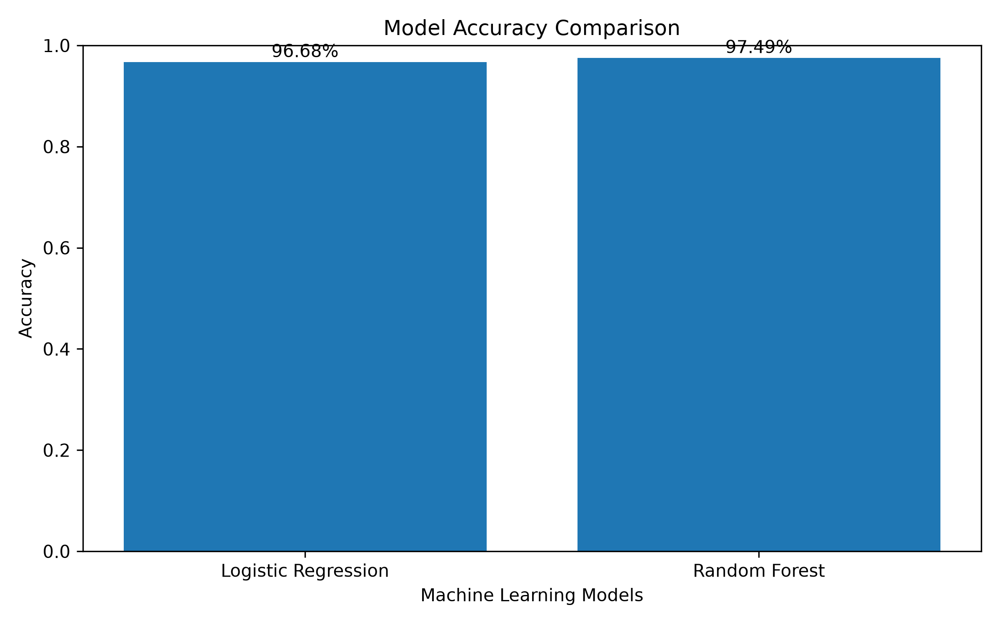
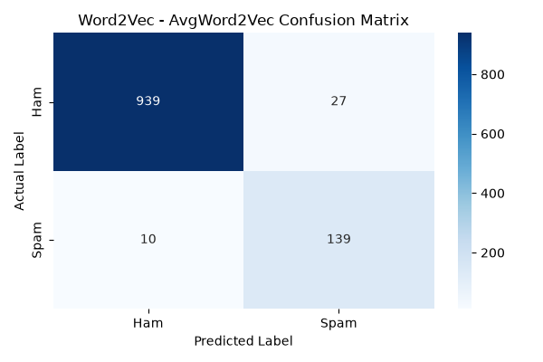

# Word2Vec-Based SMS Spam Classification

A Natural Language Processing (NLP) and Machine Learning project that classifies SMS messages as **Ham (legitimate)** or **Spam (unwanted)** using Word2Vec embeddings and machine learning classifiers.

## Project Overview

This project explores how Word2Vec converts text into numerical word representations and how Average Word2Vec creates fixed-size feature vectors for text classification.

Two machine learning models are trained and evaluated:

- Logistic Regression
- Random Forest Classifier

The objective is to compare their performance on the SMS Spam Collection dataset.

## Key Features

- Text preprocessing and tokenization
- Word embeddings using Word2Vec
- Average Word2Vec feature extraction
- Logistic Regression classification
- Random Forest classification
- Model evaluation using accuracy, precision, recall and F1-score
- Confusion matrix and model comparison visualization
- Saved models for future predictions

## Technologies Used

- Python
- Pandas and NumPy
- NLTK
- Gensim
- Scikit-learn
- Matplotlib
- Joblib

## Project Structure

```text
Word2Vec_Text_Classification/
│
├── data/
│   └── SMSSpamCollection
│
├── models/
│   ├── logistic_regression.pkl
│   ├── random_forest.pkl
│   └── word2vec.model
│
├── results/
│   ├── model_comparison.png
│   └── word2vec_confusion_matrix.png
│
├── src/
│   ├── preprocessing.py
│   ├── train.py
│   └── predict.py
│
├── .gitignore
├── requirements.txt
└── README.md
```

*Note: The dataset, trained model files and virtual environment are excluded from Git tracking.*

## Dataset

This project uses the **SMS Spam Collection Dataset**, containing 5,572 SMS messages:

- Ham: 4,825 messages
- Spam: 747 messages

Dataset source: [UCI Machine Learning Repository – SMS Spam Collection](https://archive.ics.uci.edu/dataset/228/sms+spam+collection)

## Project Workflow

1. Load the SMS dataset.
2. Preprocess messages using lowercase conversion, text cleaning and tokenization.
3. Split the dataset into training and testing sets.
4. Train Word2Vec using training messages.
5. Convert messages into Average Word2Vec feature vectors.
6. Train Logistic Regression and Random Forest classifiers.
7. Evaluate and compare model performance.
8. Save trained models and evaluation visualizations.

## Model Performance

The following results were obtained from the current training run:

| Model | Accuracy |
|---|---:|
| Logistic Regression | 96.68% |
| Random Forest | 97.49% |

### Model Accuracy Comparison



### Confusion Matrix



### Classification Insights

- Logistic Regression achieved 93% recall for the Spam class.
- Random Forest achieved 85% recall for the Spam class.
- Random Forest achieved higher overall accuracy in this training run.

Accuracy alone does not tell the whole story. Spam recall is also important because it measures how many actual spam messages the model identifies.

## Installation and Setup

### 1. Clone the repository

```bash
git clone https://github.com/skhumera0202/Word2Vec_Text_Classification.git
```

### 2. Navigate to the project directory

```bash
cd Word2Vec_Text_Classification
```

### 3. Create a virtual environment

```bash
python -m venv .venv
```

### 4. Activate the environment

Windows PowerShell:

```powershell
.\.venv\Scripts\Activate.ps1
```

### 5. Install dependencies

```bash
pip install -r requirements.txt
```

### 6. Add the dataset

Download the SMS Spam Collection dataset from the UCI link above and place the extracted `SMSSpamCollection` file inside the `data/` folder.

## Run the Project

Train the models:

```bash
python src/train.py
```

Make a sample prediction:

```bash
python src/predict.py
```

## Future Improvements

- Experiment with additional Word2Vec parameters.
- Compare Word2Vec with TF-IDF and Bag of Words.
- Explore other classification algorithms.
- Improve spam detection recall.
- Build a simple web interface for predictions.

## Learning Outcomes

Through this project, I practised:

- Text preprocessing for NLP applications.
- Learning word representations with Word2Vec.
- Average Word2Vec feature extraction.
- Applying machine learning algorithms to text data.
- Evaluating classification models.
- Organizing an NLP project into reusable Python modules.

---

**Project Type:** Natural Language Processing | Machine Learning | Text Classification