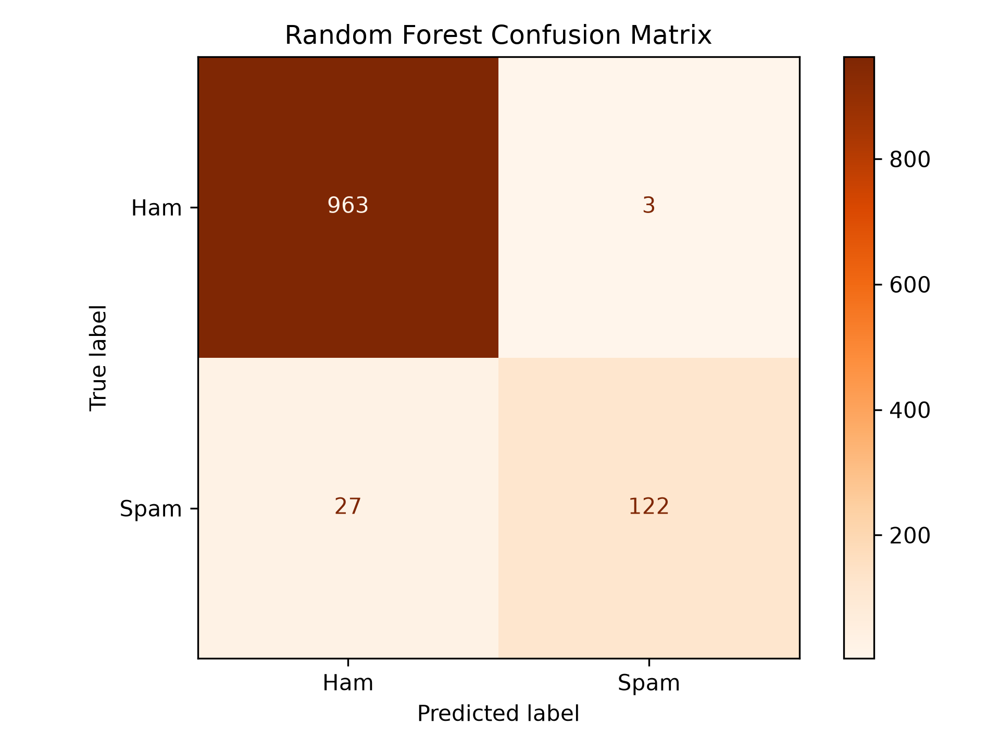

# Word2Vec-Based SMS Spam Classification

A beginner-friendly Natural Language Processing (NLP) and Machine Learning project that classifies SMS messages as **Spam** or **Ham (Not Spam)** using Word2Vec embeddings and machine learning classifiers.

The project explores how text can be converted into numerical representations using Word2Vec and Average Word2Vec, then used to train classification models.

## Project Overview

SMS spam messages are unwanted messages that may contain advertisements, suspicious links, or misleading information.

The goal of this project is to build a machine learning system that automatically identifies spam messages.

Two classification algorithms are implemented and compared:

- Logistic Regression
- Random Forest Classifier

Both models use 100-dimensional Average Word2Vec feature vectors.

## Key Features

- Text preprocessing and cleaning
- Word2Vec word embeddings using Gensim
- Average Word2Vec feature extraction
- Logistic Regression classification
- Random Forest classification
- Model evaluation using accuracy, precision, recall, and F1-score
- Confusion matrix visualizations
- Model comparison chart
- Saved trained models for future predictions

## Technologies Used

| Technology | Purpose |
|---|---|
| Python | Programming language |
| Pandas | Data handling |
| NumPy | Numerical operations |
| Scikit-learn | Machine learning |
| Gensim | Word2Vec embeddings |
| Matplotlib | Data visualization |
| Joblib | Model saving and loading |

## Dataset

This project uses the **SMS Spam Collection Dataset**.

- Total messages: 5,572
- Ham messages: 4,825
- Spam messages: 747

The dataset contains SMS messages labelled as either ham or spam.

Dataset source: [UCI Machine Learning Repository – SMS Spam Collection](https://archive.ics.uci.edu/dataset/228/sms+spam+collection)

## Project Structure

```text
Word2Vec_Text_Classification/
│
├── data/
│   └── SMSSpamCollection
│
├── models/
│   ├── logistic_regression.pkl
│   ├── random_forest.pkl
│   └── word2vec.model
│
├── results/
│   ├── model_comparison.png
│   ├── word2vec_confusion_matrix.png
│   └── random_forest_confusion_matrix.png
│
├── src/
│   ├── preprocessing.py
│   ├── train.py
│   └── predict.py
│
├── .gitignore
├── requirements.txt
└── README.md
```

**Note:** The dataset and trained model files are excluded from Git tracking through `.gitignore`. The structure above shows the local project layout.

## Project Workflow

### 1. Text Preprocessing

Raw SMS messages are cleaned before training.

The preprocessing steps include:

- Converting text to lowercase
- Removing numbers and special characters
- Tokenizing sentences into individual words

### 2. Word2Vec Embeddings

Word2Vec learns numerical representations of words based on their surrounding context.

This project uses the Skip-gram architecture (`sg=1`) to learn word embeddings.

### 3. Average Word2Vec

Word2Vec produces a vector for each word.

Average Word2Vec combines the word vectors in a message by calculating their average, producing one fixed-size numerical representation per SMS.

The resulting feature vectors have 100 dimensions.

### 4. Model Training

The extracted numerical features are used to train two classifiers:

- Logistic Regression
- Random Forest

The dataset is split into training and testing sets using an 80:20 ratio.

### 5. Model Evaluation

Both models are evaluated using:

- Accuracy
- Precision
- Recall
- F1-score
- Confusion Matrix

## Model Performance

Results from the latest training run:

| Model | Accuracy |
|---|---:|
| Logistic Regression | 96.95% |
| Random Forest | 97.31% |

### Model Comparison


### Logistic Regression Confusion Matrix


### Random Forest Confusion Matrix



### Classification Insights

- Logistic Regression achieved approximately 93% recall for the Spam class.
- Random Forest achieved approximately 82% recall for the Spam class.
- Random Forest achieved slightly higher overall accuracy in the latest training run.
- Logistic Regression identified a larger proportion of actual spam messages.

**Key takeaway:** Accuracy alone is not enough to evaluate a spam classifier. Recall is also important because it measures how many actual spam messages are correctly identified.

*Note: Results may vary slightly between training runs.*

## Installation and Setup

### 1. Clone the Repository

```bash
git clone https://github.com/skhumera0202/Word2Vec_Text_Classification.git
```

### 2. Navigate to the Project Folder

```bash
cd Word2Vec_Text_Classification
```

### 3. Create a Virtual Environment

```bash
python -m venv .venv
```

### 4. Activate the Environment

For Windows PowerShell:

```powershell
.\.venv\Scripts\Activate.ps1
```

### 5. Install Dependencies

```bash
pip install -r requirements.txt
```

### 6. Run the Training Script

```bash
python src/train.py
```

The training script will train both classification models, evaluate their performance, save the trained models, and generate visualizations inside the `results/` folder.

## Making Predictions

After training, you can use the prediction script to classify new SMS messages.

```bash
python src/predict.py
```

The prediction script loads the saved models and Word2Vec embeddings to make predictions on new messages.

## Learning Outcomes

Through this project, I learned:

- Text preprocessing techniques in NLP
- How Word2Vec generates word embeddings
- The concept of Average Word2Vec
- Converting text into numerical feature vectors
- Training machine learning classifiers on text data
- Comparing Logistic Regression and Random Forest
- Evaluating classification models using multiple metrics
- Saving and loading trained machine learning models
- Organizing an NLP project for GitHub

## Future Improvements

- Experiment with different Word2Vec parameters.
- Explore TF-IDF and other text representation techniques.
- Perform hyperparameter tuning.
- Improve spam detection recall.
- Explore advanced NLP models such as LSTM and BERT.

## Author

**Humera Shaikh**

Aspiring Machine Learning Engineer | Exploring NLP, Machine Learning and MLOps

- GitHub: [skhumera0202](https://github.com/skhumera0202)
- Project Repository:https://github.com/skhumera0202/Word2Vec_Text_Classification.git

